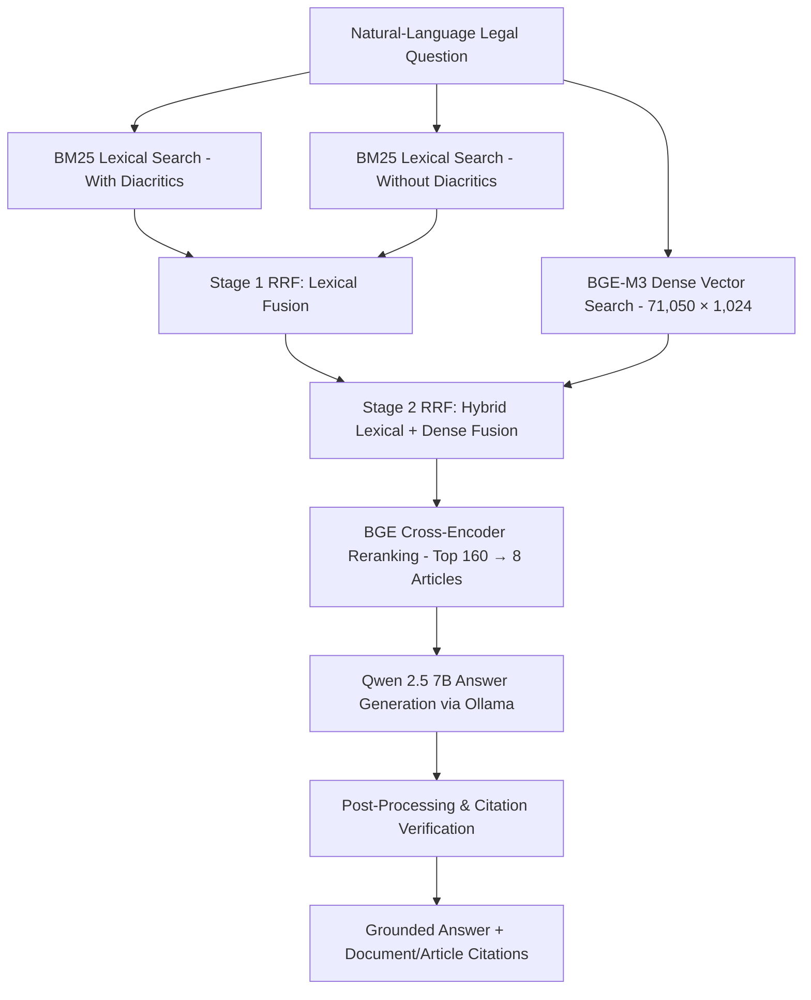

# AI Legal Assistant

## [Try the Live Preview →](https://ai-legal-assistant-preview.onrender.com/)

A Vietnamese business-law question-answering system powered by **hybrid retrieval (BM25 + BGE-M3), two-stage Reciprocal Rank Fusion, Cross-Encoder reranking and citation-grounded generation**.

**Python · FastAPI · BM25 · PyVi · BGE-M3 Embeddings · Reciprocal Rank Fusion · BGE Reranker · Qwen 2.5 (Ollama) · NumPy · SQLite · Docker · GitHub Actions**

> **Live Demo Mode:** The hosted Render deployment runs in lightweight **Archive Preview Mode**, serving **2,000 pre-computed submission answers** (including 6 bilingual English/Vietnamese examples) from a read-only SQLite database with zero cloud GPU cost. Full end-to-end RAG inference (`BGE-M3` + `BGE Reranker` + `Qwen 2.5 7B`) is supported for local execution.

---

## Why I Built It

Legal regulations for small and medium-sized enterprises (SMEs) in Vietnam span thousands of decrees, circulars and laws, making it difficult to pinpoint the exact articles applicable to a business question. I built this system to connect natural-language questions to a canonical corpus of **71,050 statutory articles** and return grounded answers alongside verifiable document and article references.

This repository refactors the original competition notebook pipeline into a modular FastAPI web service and interactive legal search interface while preserving the exact retrieval, reranking and citation-selection algorithms.

## System Architecture



### Key Pipeline Components

| Component | Technical Implementation |
| --- | --- |
| **Dual BM25 Lexical Retrieval** | Searches Vietnamese statutory text both with and without diacritics using `PyVi` word segmentation (`top_k = 200` per branch). |
| **BGE-M3 Dense Retrieval** | Encodes queries into 1,024-dimensional embeddings and computes exact NumPy dot-product similarity against the memory-mapped `71,050 × 1,024` article matrix (`top_k = 200`). |
| **Two-Stage Reciprocal Rank Fusion (RRF)** | Fuses diacritic and non-diacritic BM25 rankings (`top 160`), then fuses the lexical family with dense retrieval (`top 200`, `rrf_k = 60`). |
| **Cross-Encoder Reranking** | Reranks the top 160 fused candidates using `BAAI/bge-reranker-v2-m3` and selects the top 8 articles as grounded LLM context. |
| **Qwen 2.5 7B Generation** | Generates structured Vietnamese legal responses conditioned strictly on the reranked statutory context via Ollama. |
| **Citation Selector & Guardrails** | Applies domain/lexical overlap heuristics, score-band filtering (`0.90–0.92`) and selective LLM veto checks to attach up to 3 verified article citations per answer. |
| **FastAPI Service & Bilingual UI** | Serves a single-column legal search interface with English/Vietnamese tabs for curated examples, searchable access to all 2,000 archived questions and SHA-256 artifact checksum verification. |

Pipeline hyperparameters are stored in [`submission_v6_3.json`](src/legal_assistant/configs/submission_v6_3.json).

---

## Quick Start (Archive Preview Mode)

The preview mode requires no API keys, GPU or model downloads. It builds a read-only SQLite database from the checksummed `archive/submission_answers.json` bundle (2,000 questions and answers):

```bash
git clone https://github.com/letriluan/AI-Legal-Assistant.git
cd AI-Legal-Assistant
python -m venv .venv
# Activate: .venv\Scripts\Activate.ps1 (PowerShell) or source .venv/bin/activate (macOS/Linux)
python -m pip install -c requirements-lock.txt -e ".[dev]"
python scripts/build_preview_db.py
python -m uvicorn legal_assistant.app:app --host 127.0.0.1 --port 8004
```

Open **http://127.0.0.1:8004** in your browser, or run via Docker Compose:

```bash
docker compose up --build
```

---

## Running Full RAG Inference Locally

To run live retrieval, reranking and generation on new questions:

1. Install model dependencies:
   ```bash
   python -m pip install -e ".[models]"
   ```
2. Point `LEGAL_DATA_DIR` to the directory containing the corpus and precomputed index artifacts (`bm25_dual_with_docs_phapdien64_web_canonical.pkl` and `dense_bge_m3_phapdien64_web.npy`). Before loading any pickle or NumPy file, `runtime.py` verifies its SHA-256 digest against [`artifact_manifest.json`](src/legal_assistant/configs/artifact_manifest.json). See [Data and Models](docs/DATA.md).
3. Ensure `BAAI/bge-m3` and `BAAI/bge-reranker-v2-m3` checkpoints are available locally (or set `MODEL_LOCAL_FILES_ONLY=false` to download from Hugging Face).
4. Start Ollama with the `qwen2.5:7b` model:
   ```bash
   ollama pull qwen2.5:7b
   ```
5. Set `APP_MODE=rag` and start the FastAPI server:
   ```bash
   python -m uvicorn legal_assistant.app:app --host 127.0.0.1 --port 8004
   ```

To reproduce batch competition predictions from the command line:

```bash
python scripts/reproduce_submission.py --questions /path/to/R2AIStage1DATA.json --limit 10
```

---

## Testing, Validation & CI/CD

GitHub Actions automatically runs dependency verification, Ruff linting, offline artifact checksum validation, `pytest` suites and Docker image builds on every push:

```bash
python -m pip install -c requirements-lock.txt -e ".[dev]"
ruff check .
python scripts/build_preview_db.py
pytest -q
python scripts/check_artifacts.py
```

- **Automated Test Suite (`tests/`):** Covers API request validation, read-only SQLite archive enforcement, bilingual example mapping, sanitized error responses, concurrency locking (`HTTP 429` with `Retry-After`), SHA-256 artifact verification, RRF rank fusion, Vietnamese tokenisation and citation post-processing.
- **Corpus Integrity Verification:** Validated 71,050 aligned BM25/JSONL document records and a `71,050 × 1,024` `float32` BGE-M3 embedding matrix via SHA-256 checksums.

---

## Repository Structure

| Path | Description |
| --- | --- |
| `src/legal_assistant/app.py`, `service.py` | FastAPI endpoints, input validation and preview/RAG mode dispatch |
| `src/legal_assistant/runtime.py` | SHA-256 artifact verification and lazy model initialisation |
| `src/legal_assistant/pipeline_core.py` | Core hybrid retrieval (BM25 + BGE-M3), two-stage RRF, reranking and citation selection |
| `src/legal_assistant/configs/` | Pipeline hyperparameters (`submission_v6_3.json`), SHA-256 manifest and curated bilingual examples |
| `src/legal_assistant/ui/` | Single-column legal search interface (`index.html`, `styles.css`, `app.js`) |
| `archive/`, `scripts/build_preview_db.py` | Checksummed 2,000-answer archive and read-only SQLite builder |
| `notebooks/submission_pipeline.ipynb` | Original end-to-end research and competition notebook |
| `scripts/data_pipeline/` | Corpus canonicalisation, deduplication and BM25 index construction scripts |
| `tests/` | Unit and API regression tests |

## Disclaimer

This project is an engineering and research prototype for legal information retrieval and does not constitute legal advice. Always verify cited articles, amendments and effective dates against official statutory publications.
