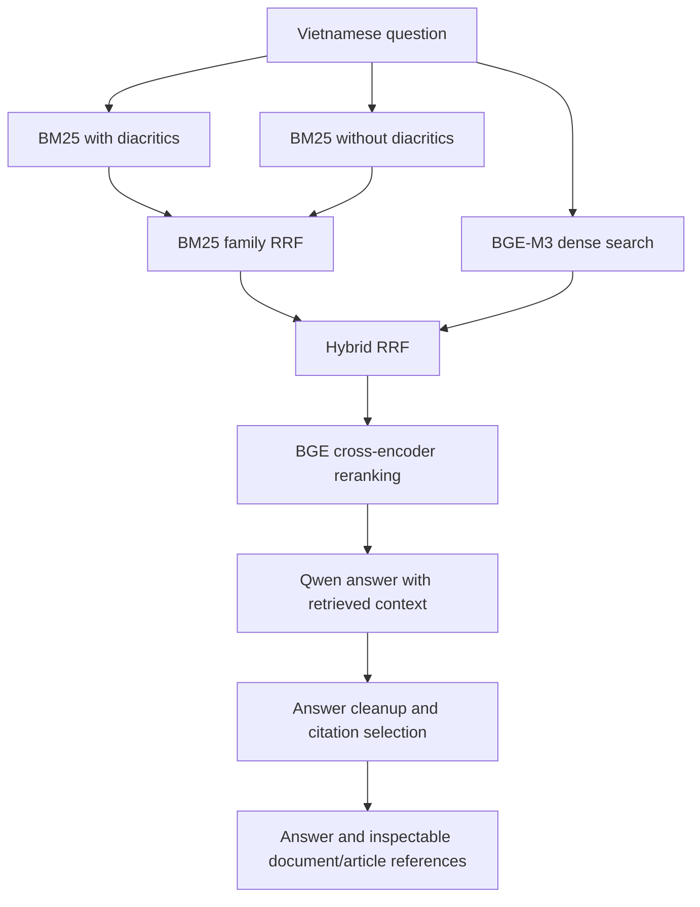

# AI Legal Assistant

A Vietnamese legal question-answering project for small and medium-sized enterprises, using **hybrid retrieval, cross-encoder reranking and citation-aware generation**.

**Python · FastAPI · BM25 · PyVi · BGE-M3 · Reciprocal Rank Fusion · BGE Reranker · Ollama/Qwen · NumPy · Docker**

> The default app is a clearly labelled **bilingual saved-example preview**. Full RAG model inference has not been rerun in this refactor, and there is no hosted demo yet.

## Why I Built It

Vietnamese legal information is spread across many documents, making it difficult to identify the articles relevant to a specific business question. I built this project to let users ask questions in natural language, retrieve supporting legal context and inspect the document/article references behind an answer.

The original competition submission contained a canonical corpus of **71,050 article records** and outputs for **2,000 questions**. This repository separates that notebook workflow from a local API and browser interface, while retaining the submitted retrieval and citation-selection algorithms.

## What It Builds

| Component | Role |
| --- | --- |
| Dual BM25 | Searches Vietnamese text both with and without diacritics using PyVi tokenisation |
| BGE-M3 dense retrieval | Embeds the question and ranks the stored 1,024-dimensional article vectors using a NumPy dot product |
| Two-stage RRF | First fuses the two BM25 rankings, then combines that family with dense retrieval |
| BGE cross-encoder | Reranks up to 160 fused candidates and keeps eight context articles |
| Qwen 2.5 7B via Ollama | Generates Vietnamese answers conditioned on retrieved context |
| Citation selector | Uses domain/overlap heuristics, selective LLM veto checks and a same-document score-band rule to choose references |
| FastAPI + browser | Validates questions, displays answers and expandable article references; permits one request at a time |

**This source uses NumPy dense search, not FAISS.** It also does not use LangGraph, MCP, Microsoft Copilot Studio or Power Platform. The current workflow is a retrieval/generation pipeline rather than a general tool-using agent.

## Bilingual Demo

The interface uses English project descriptions and sample questions, with Vietnamese originals underneath. The six curated English questions map to their original Vietnamese submission inputs. Saved responses open on an **English translation** tab and retain an **Original Vietnamese** tab; copying an answer copies the currently displayed language. Document codes remain unchanged, with descriptive English titles and the original Vietnamese references available together.

Translations were prepared for presentation, not generated by the live RAG model, and are not official legal translations. They preserve the archived answers rather than silently correcting them. The accounting example explicitly flags a mismatch between the document named in the answer and its stored reference list. Unknown questions are not automatically translated; in full RAG mode, only the curated question aliases map to Vietnamese, and new model answers remain Vietnamese without an archived English answer being substituted.

## Architecture



The submitted `v6.3` settings retrieve 200 candidates per lexical/dense branch, retain 160 in the lexical family, fuse to 200, rerank 160 and retain eight for generation. Citation output is capped at three articles. These settings are preserved in [`submission_v6_3.json`](src/legal_assistant/configs/submission_v6_3.json).

Citation selection narrows reported sources; it is **not proof that every answer is supported or legally current**. The local corpus contains documents from different years, and effective-date selection is not a complete runtime guarantee.

## Run the Local Preview

The preview requires no API key, Ollama server, model weights or full corpus. It returns **six saved submission examples**, preserving the original Vietnamese answers and adding prepared English translations. A different question receives an explanation instead of a fabricated model answer.

```bash
git clone https://github.com/letriluan/AI-Legal-Assistant.git
cd AI-Legal-Assistant
python -m venv .venv
# Activate: .venv\Scripts\Activate.ps1 (PowerShell)
# or: source .venv/bin/activate (macOS/Linux)
python -m pip install -c requirements-lock.txt -e ".[dev]"
python -m uvicorn legal_assistant.app:app --host 127.0.0.1 --port 8004
```

Open **http://127.0.0.1:8004**. If you create a `.env`, start from `.env.example`; its default `APP_MODE=preview` is explicit.

Alternatively:

```bash
docker compose up --build
```

Compose exposes only **127.0.0.1:8004**, runs as a non-root user and contains neither the full dataset nor pretrained models. It serves the saved-output preview, not full RAG. Stop with `docker compose down`.

## Full RAG Setup

This mode is prepared but **not end-to-end verified in the current refactor**. Model downloads were deliberately deferred. The original notebook and output files provide historical submission evidence, not a successful new live run.

1. Install optional model dependencies with `python -m pip install -e ".[models]"`.
2. Set `LEGAL_DATA_DIR` to the original artifact directory, as described in [Data and Models](docs/DATA.md).
3. Make the `BAAI/bge-m3` and `BAAI/bge-reranker-v2-m3` checkpoints available locally. Model loading is cache-only by default (`MODEL_LOCAL_FILES_ONLY=true`). Set it to `false` only when you intend to download weights.
4. Start Ollama and make `qwen2.5:7b` available. Configure `OLLAMA_HOST` if required.
5. Set `APP_MODE=rag`, then start Uvicorn as above. The first question initializes the corpus and models. `/ready` returns 503 until initialization succeeds; `/health` checks the process only.

Do not replace BGE-M3 with a different embedding model while reusing the submitted matrix: compatible dimensions alone do not make embeddings interchangeable. The full setup needs substantially more resources than the preview and has not been validated on Render Free. Use a machine with suitable RAM/model capacity; GPU availability does not by itself guarantee that the embedding model, reranker and Qwen all fit concurrently.

### Original batch reproduction

[`notebooks/submission_pipeline.ipynb`](notebooks/submission_pipeline.ipynb) preserves the original clean notebook. The extracted batch function retains incremental JSON checkpointing, resume support and ZIP output. After full model setup, you can opt into a small run:

```bash
python scripts/reproduce_submission.py --questions /path/to/R2AIStage1DATA.json --limit 1
```

Use `--all` for the full batch. This is a real local model run, not the preview, and can take significant time. It has not been rerun in this local preparation.

## Validation

Current local evidence:

- **19 offline tests previously passed on Windows and Docker/Linux** for API validation, explicit preview behaviour, sanitized failures, concurrency rejection, rank fusion, Vietnamese tokenisation, small-corpus top-k bounds, reranking/formatting and long-context handling.
- Full artifact checks found **71,050 matching BM25/JSONL document identities**, a finite `float32` matrix of **71,050 × 1,024**, and matching supplied-artifact checksums. No model weights were loaded.
- All six saved examples returned answers and references through the running HTTP API. This validates replay and transport, not retrieval accuracy or generated-answer quality.
- Docker build and container API smoke checks passed. Ruff, dependency checks and JavaScript syntax checks passed. The retained notebook/legacy data tools and extracted core are excluded from Ruff to preserve their submitted form; application code is linted.
- Browser automation is disabled in the current environment, so the new UI has **not been visually verified**. The source is available for local review.

The source package labels one historical output folder `submiss_0.6543_public` and reports `0.6543`. No official scoring report or metric definition was included in the package, so this is **not presented as 65.43% accuracy** or as a reproduced benchmark result.

See [provenance and refactor changes](docs/PROVENANCE.md). Full live retrieval, generation, citation quality and cross-platform model compatibility remain to be tested.

The bilingual update is validated separately with API checks for all six English/Vietnamese aliases, original-answer preservation, explicit translation labels and no reuse of archived translations for live model answers. See `docs/local-validation.json` for the latest local run.

## CI and Delivery

A **prepared GitHub Actions CI workflow** installs dependencies, runs lint/tests and offline artifact-format checks, validates Compose and builds the preview Docker image. It does not download pretrained models, run the full dataset or measure legal-answer accuracy.

Source code is published at [letriluan/AI-Legal-Assistant](https://github.com/letriluan/AI-Legal-Assistant). GitHub Actions validates pushes and pull requests; it does not deploy the application. There is no CD integration or hosted demo yet. Full inference must be validated before hosting the full RAG pipeline.

## Development

```bash
python -m pip install -c requirements-lock.txt -e ".[dev]"
python -m pip check
ruff check .
pytest -q
python scripts/check_artifacts.py
```

`requirements-lock.txt` records the tested Python 3.12 app/offline environment (without optional Torch/sentence-transformers). `pyproject.toml` declares compatible version ranges. The original notebook did not include a full training/inference lockfile, so historical model-environment reproducibility is not established.

## Repository Guide

| Path | Contents |
| --- | --- |
| `src/legal_assistant/app.py`, `service.py` | Validated API and explicit preview/full-mode dispatch |
| `src/legal_assistant/runtime.py` | Checksummed artifact loading and optional model orchestration |
| `src/legal_assistant/pipeline_core.py` | Extracted original retrieval, prompting, cleanup and citation algorithms |
| `src/legal_assistant/configs/` | Original settings, artifact checksums and six archived example outputs |
| `src/legal_assistant/ui/` | Browser interface with safe text rendering |
| `notebooks/` | Original submitted notebook with no saved outputs |
| `scripts/data_pipeline/` | Retained original canonicalisation and corpus-build tools |
| `tests/` | Model-free regression checks |
| `docs/` | Data/model requirements, provenance and limitations |

## Scope and Limitations

This is an educational/research prototype, not legal advice. Always verify cited text, amendments and current applicability against authoritative sources before relying on an answer. Archived examples are historical system outputs and have not been independently certified as correct.

The app has no authenticated users, tenant permissions, public rate limiter, prompt-injection defence evaluation or audited legal-validity engine. The legacy verifier can retain candidates after verifier failures; see provenance notes. Readiness distinguishes preview from loaded full RAG but does not validate answer quality. The current full-mode runtime uses process-global pipeline state and must run with **one worker** and one in-flight request.

Large artifacts, raw legal documents, the full question/output sets and model weights remain local and excluded from Git. Only six labelled output examples are included for the preview. The provided submission package did not include a complete corpus redistribution licence; no permission to redistribute the full dataset or models is implied. No new repository-wide licence has been assigned on behalf of other contributors.
